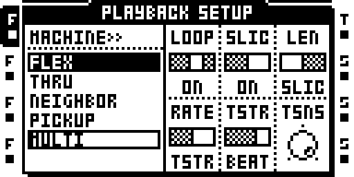
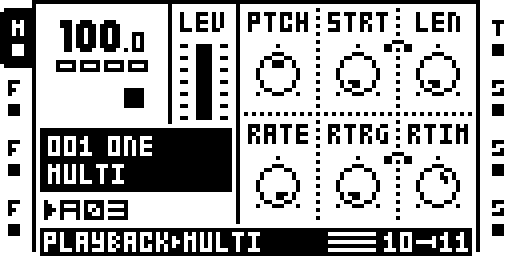
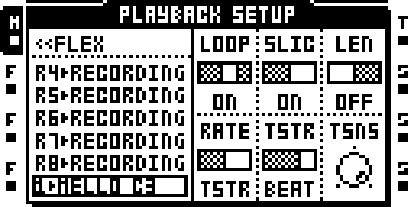
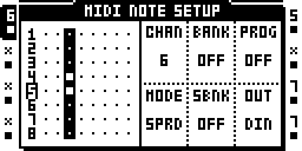

# MULTI-SAMPLER

A multisampler for the Octatrack MKI/MKII (OS 1.40C), built as two
[octabam](https://github.com/sambanks/octabam) modules:

- **[MULTI](multi/)** — a sixth machine beside STATIC, FLEX, THRU, NEIGHBOR and PICKUP. One audio
  track plays up to **eight voices**, each with its own sample and pitch. A set of FLEX slots named by
  note (`CHOIR C3.wav`, `CHOIR C#3.wav` …) plays as one instrument: every note picks the file with the
  nearest note.
- **[MIDI ROUTING](midi-routing/)** — a routing map in a MIDI track's NOTE SETUP: which MIDI tracks
  play which audio tracks, saved with the project. It feeds MULTI (and plain FLEX / STATIC tracks).

> **Work in progress.** Measured under the octabam ColdFire emulator; the first unit runs found a
> freeze and grainy audio with a 35-slot set (fixed in the current source, see "History"). Not yet
> confirmed on hardware.

---

## Quick start

| Step | Where | What |
|---|---|---|
| 1 | Your computer | Name each file with its note: `CHOIR A#2.wav`. The note must stand on its own: `CHOIR C3`, `CHOIR_C3`, `CHOIR-C#3` work; `CHOIRC3` doesn't. C3 = MIDI 48. |
| 2 | Octatrack | Load the files into FLEX slots in a row (any order inside the run is fine, the names decide). |
| 3 | Audio track, **FUNC + SRC** | Pick **MULTI**, YES. Press **RIGHT** for the `<<FLEX` slot list, pick any file of the set, YES. |
| 4 | Same page | **LOOP** and **TSTR** off. |
| 5 | MIDI track, **FUNC + SRC** | In NOTE SETUP's map, arrows to the audio track's row, **YES**. **D: MODE ALL** for one MULTI track. |
| 6 | Play | The MIDI track's trigs, CHROMATIC keys, CHORDS, an external keyboard on the MIDI track's CHAN — or the audio track's own CHROMATIC keys. |

*PLAYBACK SETUP: MULTI is the sixth machine (boxed: the cursor).*

*A MULTI track: `M` on its tab, `PLAYBACK▸MULTI` in the footer. Its pages are FLEX's.*

*RIGHT on MULTI opens the FLEX slots: pick any file of the set.*

*NOTE SETUP: MIDI tracks across, audio tracks down. Here M3 plays T4 and T5; D is MODE, F is OUT.*

---

## How it plays

- **Eight voices a track.** The stock voice plus seven more. A ninth note takes the oldest.
- **Each voice its own file.** The note picks the nearest-note slot among the run of slots around the
  track's sample that share its name, and plays it with a PTCH lock (at most ±12 semitones from that
  file).
- **Cheap when every key is sampled.** A note with its own file plays at its own speed, so the voice
  is copied straight into the mix — no interpolation. Notes between files are resampled (POLY's
  linear interpolation).
- **Mix:** every voice at -6 dB however many sound (a note keeps its level as others join); the
  mix clips, never wraps, past full scale.
- **Stacking:** route a MIDI track to two MULTI tracks with MODE **LINK** and it fills one track's eight
  voices, then the next: 16 voices, each track with its own AMP, FX and level (not yet tested with
  two MULTI tracks). A layer is another
  MULTI track with another set, ticked for the same MIDI track (MODE ALL).

Memory: the set loads once into FLEX RAM (85.5 MB a project, shared) however many voices or tracks
play it.

---

## MIDI ROUTING

| Control | What it does |
|---|---|
| Arrows | Move the cursor: its MIDI track's column inverted, its audio track's number boxed. |
| YES | Route / unroute that cell. With a CHAN / BANK / PROG / SBNK edit waiting, YES applies that instead (stock). |
| D: MODE | **LINK**: one note a track (a MULTI track counts as eight). **ALL**: every note on every routed track. |
| FUNC + D: IN | **ON** (default): a keyboard on the MIDI track's CHAN plays its routed audio tracks, and stock's audio note-in ignores that channel. **OFF**: MIDI IN as stock. D alone shows MODE again. |
| F: OUT | Where the routed notes also go: **OFF**, **DIN**, **USB**, **BOTH**. |

**MIDI IN:** a note from outside on a routed MIDI track's CHAN (or on the auto channel in MIDI mode,
for the active MIDI track) plays its audio tracks too, over the whole note range. Stock still passes
it on to MIDI OUT as before. With IN ON (FUNC + D) stock's audio note-in ignores that channel, so no track trigs,
mutes or doubled notes.

A new project starts with M1 → T1 … M8 → T8 and OUT BOTH (external gear still plays); untick a cell
to stop a route. A MIDI track needs a CHAN for its notes to play. Unrouted MIDI tracks are stock.

---

## Files

| Path | What |
|---|---|
| `multi/multi.s` | The machine: POLY MACHINE's hooks with seven extension voices, the fast path, the mix; `mu.c` compiled and appended. |
| `multi/mu.c` | The multisample: name parsing, the per-track note → slot / PTCH map (built outside the audio path), MIDI ROUTING's entry. |
| `multi/manifest.py` | The octabam module declaration (hooks, pokes). |
| `midi-routing/rt.c`, `rt.s` | The router, the NOTE SETUP map and keys; `rt.c` compiled into `rt.s`. |
| `midi-routing/manifest.py`, `brain.lock` | Its declaration and its BRAIN settings (per project). |

The C is compiled with `m68k-linux-gnu-gcc -mcpu=54455 -O2 -fomit-frame-pointer -fno-pic -S` and
pasted into the `.s` units (labels prefixed, sections joined). Edit the `.c`, regenerate the unit.

To build: copy `multi/` and `midi-routing/` into an octabam checkout's `modules/` and add `"MULTI"`
and `"MIDI ROUTING"` to a remix. MULTI can't share a build with POLY MACHINE, OCTA303 or SYNTH
MACHINE (same machine slot and hooks); MIDI ROUTING not with MIDI LOOPBACK, MIDI FOLLOW or 303
FOLLOW. No Elektron code is in this repo: the build patches your own 1.40C.

---

## History

- **MIDI ROUTING** — the map, cursor, MODE and OUT.
- **MULTI, first build** — eight voices, the fast path, the multisample. On the unit with 35 slots:
  only a few notes, grainy, then a freeze. The slot names were parsed while audio was paused
  (~100 names a note).
- **Fix** — the name → slot map is built once, outside the audio path, and only read during
  playback; a chord's later voices take the increment their note was rendered with. Emulator: 35
  slots, 8-note chords, every voice its own file, all on the fast path.
- **Audio locks on routed notes** — a note a MIDI track plays on an audio track takes that track's
  step locks (a trig's or a trigless lock's), read from the pattern as the note starts: the nearest
  step back with a trig or lock, so an erased lock stops applying. The first version read the locks
  31 bytes off (none found); fixed (OctaZach 216).
- **Legato** — every key let go and a new one pressed at the same moment (a CHORDS chord change)
  ended the new notes before they sounded: the last key's release was still waiting and was taken
  after them. A press now withdraws a release still waiting (OctaZach 218).

---

## Credits

MULTI is a fork of **POLY MACHINE** by repeat98
([octamad, poly-machine 887a237](https://github.com/repeat98/octamad/tree/887a237686d39defb7b85f29359f1e29b9ff6241/modules/poly-machine),
MIT, see `LICENSE-POLY-MACHINE`). Built on **octabam** by Sam Banks and contributors (MIT). The
MIDI-track sender hook follows radiohagen's MIDI LOOPBACK. Changes and new code by Slingdinger.
